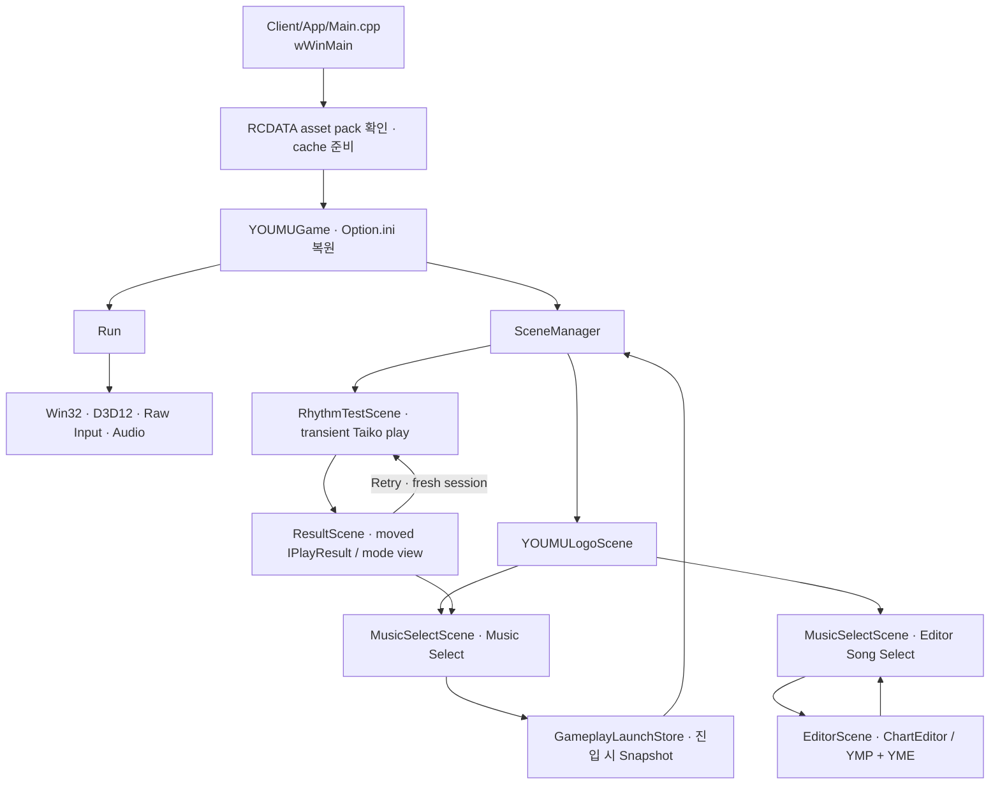

# Client 실행 흐름과 객체 수명

엔진은 Win32, D3D12, 입력, FMOD와 프레임 루프를 소유하고 Client는
게임 설정과 Scene을 소유합니다.

곡 목록은 Scene이 소유한 SongCatalogLoader worker에서 준비하고 완료 결과만 게시합니다.
플레이 진입에서는 Session을 먼저 받은 뒤 PNG를 비동기 준비하고 Canvas/오디오를 구성합니다.
공통 IPlaySessionController의 Loading→Gameplay→Pause→Ending 상태로 실행합니다.
Clip/음악 탐색 준비가 끝나면 Controller가 같은 미래 QPC/DSP 시점에 타이머와 음악을 시작합니다.
Pause는 살아 있는 음악 Voice를 유지하고 복귀 시 위치를 재정렬합니다. transient 샘플은 정지하며
Ending은 모든 세션 음성을 정리하고 모드별 결과 소유권을 한 번 넘깁니다.
세부 전환과 Retry 자원 재사용은 [플레이 상태](Gameplay/Pause.md#모든-모드의-실행-상태)를 참고합니다.
대기 중 Scene이 보관하는 EngineServices 사본은 Run 소유 서비스의 비소유 참조이며,
OnResize에서 창 크기를 갱신하고 Shutdown에서 해제합니다. worker는 경로/데이터만 소유합니다.

## 시작

1. `wWinMain`이 Debug CRT 누수 검사를 켜고 EXE의 RCDATA 기본 자산 팩을
   `%LOCALAPPDATA%/YOUMU/BuiltInAssets/<pack hash>`에 준비합니다. 같은 팩의
   유효한 캐시가 있으면 다시 기록하지 않습니다.
2. 일반 실행과 YOUMU smoke는 `YOUMUGame`을 생성합니다. EXE 옆
   `Option.ini`에서 언어·스킨·오디오 미들웨어/출력 방식/드라이버·창 크기·모드별 키·글로벌 오프셋을 읽습니다.
   파일이 없으면 기본 설정을 저장합니다. 저장된 스킨
   폴더가 없으면 `Default Skin`을 사용합니다. 상세 형식은 [TextManagement](TextManagement.md)입니다.
3. `Run`이 `GetEngineConfig`를 읽어 창, 렌더러, Raw Input과 오디오를
   초기화합니다. 창 제목은 공통 `Texts/GameIdentity.h`의 `GameName`을 사용합니다.
4. `RegisterScenes`가 Logo, Lobby, EditorSongSelect, Editor, RhythmTest, Result route를 등록합니다.
5. `SceneManager`가 최초 Scene을 활성화하고 `Initialize`를 한 번 호출합니다.
   Client 초기화 hook은 첫 update/render 전에 현재 출력 장치 목록에서 저장된
   드라이버를 찾아 적용합니다. 출력 방식이 fallback됐으면 다른 API의 장치 번호를 사용하지 않습니다.

스킨은 선택한 외부 자산 루트의 `Skins/<선택한 스킨 폴더>`에서 같은 상대 경로 파일을
먼저 사용하고, 파일이 없을 때만 캐시의 내장 파일로 돌아갑니다. 곡 카탈로그는
선택한 루트의 `Songs`를 읽습니다. 개발 실행은 `Client/Assets`, 배포는 EXE 옆 `Asset`을
사용합니다. 기본 AngelDream 및 효과 테스트 파일은 외부 파일로 배포하며 빌드는
개발 폴더에 이미 존재하는 편집본을 덮어쓰지 않습니다.
세부 계약은 [내장 자산](BuiltInAssets.md)에 있습니다.

`SceneGameClient`는 SceneManager, 공통 AudioPlaybackManager와 화면
ScreenVisual2DManager를 함께 소유합니다. `YOUMUGame`은 여기에 Client 소유
`TextCatalog`를 두고 Scene factory를 통해 View/Presenter에 전달합니다. 이 객체의
현재 언어와 글꼴 profile은 KeepAlive/DestroyOnExit Scene 전환과 관계없이 유지됩니다.

엔진 루프에서 예외가 발생하면 GPU 대기를 최선으로 시도한 뒤 Client를 먼저
Shutdown하고, 그 다음 Audio와 renderer 지역 객체를 정리합니다. 따라서 Scene이
보관한 Canvas·이미지·voice는 해당 서비스를 참조할 수 있는 동안 해제됩니다.
`YOUMUGame`은 gameplay factory에 `AudioPlayback()` 참조를 전달하고,
GameplayAudioRouter는 이를 통해 재생하며 세션에 속한 ID만 관리합니다.
Scene 전환 자체는 공통 재생을 중단하지 않습니다. Client 갱신 후 끝난 재생을
정리하고 종료 시에는 Scene의 세션 정리 후 남은 전역 재생을 모두 정지합니다.

## Scene 흐름

- Logo에서 Game Start를 누르면 Lobby로 이동합니다.
- Logo의 옵션 버튼 또는 Logo/Lobby의 `Ctrl+O`는 공통 왼쪽 옵션 패널을 열며,
  언어 변경은 `TextCatalog` revision을 통해 활성 화면과 이후 Scene에 반영됩니다.
  스킨 변경은 폴더 이름을 저장하고 이후 자산 로드에 적용합니다.
  공통 패널의 오디오 ComboBox 3개는 미들웨어(FMOD만 설치)·출력 방식·드라이버입니다.
  출력 방식/드라이버는 기존 오디오 객체를 유지하면서 즉시 적용하고 Option.ini에 저장합니다.
  같은 옵션 버튼이나 ESC로 닫습니다. Songs 폴더 변경은 OptionSettings가 저장하고,
  활성 곡 선택 Scene은 루트 변경을 감지해 미리듣기를 정지하고 카탈로그를 다시 요청합니다.
  카탈로그 worker는 가장 최근 루트만 대기시키며 이전 결과를 화면에 게시하지 않습니다.
- Logo에서 Editor를 누르면 기록 패널이 없는 EditorSongSelect로 이동합니다.
  이 Scene은 Lobby의 카탈로그·미리듣기·검색·정렬·곡/난이도 탐색을 공유하며,
  난이도를 확정하면 선택 경로를 기록하고 Editor Scene으로 이동합니다.
  카드의 +는 New Difficulty/Convert .osu 팝업을 엽니다. 전자는 NewDifficultyDialog에서
  메타데이터를 입력받고 EditorPatternCreation이 새 YMP/YME를 생성한 다음 같은 진입
  snapshot/전환 경로를 사용합니다. 후자는 EditorOsuImport가 파일을 선택받아 변환기를
  백그라운드에서 실행하고 완료 시 카탈로그를 갱신합니다. worker는 Scene/엔진을 참조하지
  않으며 KeepAlive Scene이 future를 소유합니다. 취소 시에는 선택 화면에 남습니다.
- EditorWorkspace는 진입 요청의 모드에 따라 `IEditorMode`를 조립하고,
  모드의 `OpenDocument`에서 `IEditorDocument`를 받습니다. 현재 Taiko 구현은
  YMP/YME를 `ChartEditor`로 읽고 유리수 누적합과 정수 us 캐시를 만듭니다.
  악보/실시간 뷰는 같은 모델을 편집하며 변경 시에만 캐시를 다시 계산합니다.
  모드는 도구 상태·좌표 해석·노트 그리기를, EditorAnalysisController는
  모드가 제공한 파일/marker의 PCM/FFT worker를, EditorView는 공통 Canvas를 관리합니다.
  모드와 문서는 Workspace와 함께 파기되고 worker는 복사한 파일 경로만 참조합니다.
  Scene 종료 시 worker 완료를 기다리지 않고 취소를 요청합니다. worker 자체는 프로세스 수명입니다.
  Ctrl+S는 같은 폴더에 저장하며 Escape는 미저장 변경을 확인한 뒤 돌아갑니다.
- Lobby는 Penpot의 `Music Select · Sky` 화면을 Visual2D 트리로 구성합니다.
  `SongCatalog`가 외부 Songs의 AngelDream YMM과 YMP 5개 및 사용자 곡·패턴을
  연결해 표시합니다.
  포커스된 곡 카드만 난이도 목록을 펼치며 좌우키는 곡, 상하키는 난이도를
  이동합니다. 하단 BACK 버튼이나 Escape로 Logo에 돌아갑니다.
- Lobby의 GO/Enter는 선택 경로와 검증한 세션을 `GameplayLaunchStore::SetValidated`로 기록한 뒤
  RhythmTest 전환을 요청합니다. RhythmTest의 Controller는 검증한 세션을 한 번 인계받고
  별도 검증 세션이 없는 smoke/debug 진입만 `TaikoMode`로 세션을 만듭니다.
  한 개의 `RhythmTimer`로 입력, 판정, 스크롤, 음악과 히트사운드의 DSP
  예약 시각을 연결합니다.
  플레이/에디터 생성자는 store의 Snapshot을 복사하므로 활성 세션의 경로는
  다른 화면의 선택 변경으로 바뀌지 않습니다. 각 Scene의 Submodules 아래 Controller가
  논리/오디오를, View/Presenter가 Canvas/노드를 소유하고 Scene은 전환을 조립합니다.
  Snapshot에는 선택 당시 Songs 루트와 해결한 BG 경로/2D 오프셋도 포함됩니다.
  에디터 YMM 해석과 플레이 BG 로딩은 이 값을 사용하며 나중의 옵션 변경을 조회하지 않습니다.
- Logo와 Lobby는 `KeepAlive`, gameplay route는 `DestroyOnExit`입니다.
  gameplay 등록 시에는 factory만 보관하고 곡 선택 후 `ChangeScene`이 호출될
  때 해당 모드의 객체를 동적으로 생성합니다.
- gameplay에서 Escape는 [일시정지 메뉴](Gameplay/Pause.md)를 엽니다. Retire 또는
  모든 노트 처리 후 3초에 Result 전환을 요청합니다. update가 끝난 다음 `EndScene → Shutdown → delete` 순서로
  gameplay 객체가 파기되므로 다음 곡이나 모드의 상태가 남지 않습니다.
- `YOUMUGame`의 대기 슬롯으로 결과 unique_ptr를 이동하고 Result factory가 이를
  소비합니다. Result도 `DestroyOnExit`이며 `IResultView`가 모드별 표시를 맡습니다.
  BACK·Escape·Enter는 Lobby로 돌아갑니다. Retry는 플레이 선택 snapshot을 복원하고
  RhythmTest factory에서 새 세션을 생성하며 Replay는 비활성입니다. 수집/정밀도/입력 로그는
  [플레이 결과](Gameplay/Results.md)가 기준입니다.

## 프레임과 종료

에디터 진입 시 Workspace의 EditorPlayback에 AudioSystem을 연결합니다.
Space가 재생 의도를 설정하면 mode/analysis의 revision별 파일·cue를 받아 준비하고,
매 update DSP 시각으로 음악·히트사운드 예약과 편집 cursor를 갱신합니다.
Scene은 연결/Update/Shutdown만 호출합니다. 종료 시 에디터 Voice를 먼저 정지하고
취소된 비동기 Clip을 AudioSystem에 넘겨 I/O가 끝난 뒤 해제하도록 합니다.

매 update에서 엔진은 timestamp가 보존된 Raw Input 이벤트를 Client에
전달합니다. 각 Scene은 논리와 관리자가 소유한 Visual2D tree만 갱신하며,
화면 Canvas의 Update·resize·제출은 `ScreenVisual2DManager`가 수행합니다.
D3D12 command 기록과 present는 엔진이 담당합니다. 종료 시 활성 Scene부터
`Shutdown`하여 Canvas observer와 오디오 voice를 먼저 해제한 후 엔진 장치를
역순으로 종료합니다.

`YOUMUGame`의 Client hook은 F7을 감지하고 게임용 Rajdhani 글꼴의 FPS와
UPS를 Scene 렌더 뒤 우측 하단에 제출합니다. 이 표시는 Scene이나 엔진 루프의
소유물이 아니므로 Scene 전환과 관계없이 유지됩니다.
